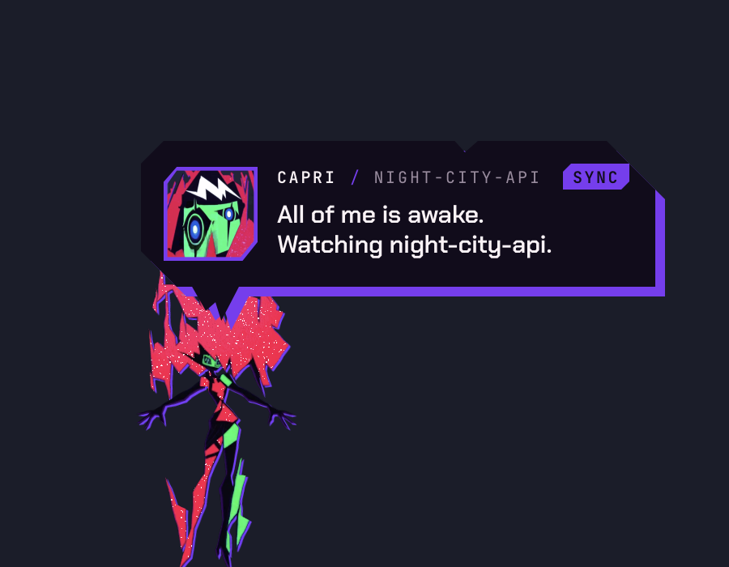

# Capri for Linux and macOS

A fork of [mochiiwuff/capri-desktop](https://github.com/mochiiwuff/capri-desktop) that moves
Capri, a desktop companion who watches Claude Code work and talks about it, off Windows and
Electron: onto a Wayland desktop (the mango compositor) and natively onto macOS.

Capri herself is upstream's work: her art, her animations and almost all of the renderer in
`src/renderer/` come from mochiiwuff's project. This fork adds the two ports and runs her chat
through Claude Code. For the original Windows app, its installer and its full feature list, go to
[upstream](https://github.com/mochiiwuff/capri-desktop).

<p align="center">
  
  
</p>
<p align="center"><sub>The macOS port running upstream's scripted demo session (<code>capri-ctl demo</code>): a session starts, then the prompt and Claude's first tool calls.</sub></p>

## What she does

- Takes Claude Code's hook events (sessions, prompts, tool calls, failures, subagents) and shows
  one plate per busy agent over her head, up to three, labeled by session when there is more than
  one, with a red dot when a tool call fails.
- Finds the window an agent runs in by walking up its process tree (through tmux if needed) and
  goes and sits on it.
- Chats. Each message is one bare `claude -p` run with Claude Code's own login: no tools, no MCP
  servers, no settings files, so no API key passes through her and her own hook never fires on her
  chat. Haiku by default; Ollama is the other backend.
- Opens and closes apps, controls Spotify and plays a song by name (see the note under "Run it"),
  keeps reminders, purrs when you stroke her mane, and reacts to the machine: CPU load, battery,
  network, USB devices.

## Why a port is more than a rebuild

Upstream is an Electron app that leans on Windows: a transparent always-on-top window, and
PowerShell to find out where the other windows are so she can sit on them. On Wayland a client
cannot see other windows or the global pointer at all. On macOS, dropping Electron means a native
overlay and `CGWindowList` in place of PowerShell.

The ports keep upstream's renderer and replace everything under it:

- **One service for both ports.** `linux/daemon/main.js` is a Node service that implements the
  `window.host` API the renderer expected from Electron, over HTTP and server-sent events on
  `127.0.0.1:47823`. The same page runs in WebKitGTK on Linux and in `WKWebView` on
  macOS. On a Mac the service swaps in `macos/daemon/` for the Linux-only modules.
- **Click-through without a shaped window.** The overlay covers the screen. The page hit-tests the
  pointer against her outline, grown by 18 px so she is easy to grab, and tells the overlay to take
  the pointer only while it is over her; every other click goes through to the desktop.
- **Windows and pointer from the compositor.** On Linux the overlay is a wlr-layer-shell surface
  (GTK4 + gtk4-layer-shell) and window positions, focus and the pointer come from mango's IPC. On
  macOS the overlay is a native `NSPanel` written in Swift (`macos/shell/main.swift`), windows come
  from `CGWindowList`, and battery, network and drives are pushed by the system instead of polled.
- **Approvals that do not go over HTTP.** The service has an approval API for an agent asking to
  use a secret. An answer is accepted only from a click in her panel, passed from the overlay to
  the service over a private pipe (fd 3), so an agent cannot approve its own request with an HTTP
  call. Nothing calls this API at the moment: the agent tools that used it were removed with the
  pi integration. See [`linux/docs/vault-approvals.md`](linux/docs/vault-approvals.md).

## Run it

You need Node 20 or newer and [Claude Code](https://code.claude.com/docs/en/quickstart) installed
and logged in.

### macOS

Needs macOS 13 or newer and the Xcode command line tools to build the overlay app. The launcher
and `capri-ctl` are shared with Linux, which is why they live in `linux/bin/`.

```sh
git clone https://github.com/minomat180/capri-desktop.git && cd capri-desktop
npm install --omit=dev --ignore-scripts   # her two fonts and xterm.js; Electron is not needed
macos/shell/build.sh                      # builds macos/shell/Capri.app
node scripts/install-hooks.js             # adds her hooks to ~/.claude/settings.json (with a backup)
linux/bin/capri                           # logs to ~/.local/state/capri/capri.log
```

Ctrl+Option+C puts her away and brings her back. `linux/bin/capri-ctl show|hide|stow|menu|chat|demo|quit`
drives her from a shell, and `macos/bin/capri-login install` starts her at login. Details, and how
each part differs from Linux: [`macos/README.md`](macos/README.md).

### Linux (mango)

The Linux port is written for the [mango](https://github.com/mangowm/mango) Wayland
compositor (0.15 or newer) and checks for it at start. It also needs GTK 4, gtk4-layer-shell,
WebKitGTK 6.0, PyGObject with pycairo, and `curl` for `capri-ctl`; `playerctl`, `rofi`, `foot`,
`gtk-launch`, `tmux`, `secret-tool` and `wl-copy` are used when present. gtk4-layer-shell is
preloaded from `/usr/lib/libgtk4-layer-shell.so.0` (Arch's path); set `CAPRI_LAYER_SHELL_LIB`
elsewhere. Its GObject typelib is vendored in `linux/shell/typelib/` for distributions that do not
ship one. The demo opens a `foot` window with app id `capri-demo`; give it a floating window rule
in mango.

```sh
npm install --omit=dev --ignore-scripts
node scripts/install-hooks.js
linux/bin/capri                           # or: linux/bin/capri --foreground
linux/bin/capri-ctl stow                  # bind this to a key in mango
```

Restart open Claude Code sessions after installing the hooks; `node scripts/install-hooks.js --uninstall`
removes them again. Settings for both ports live in `~/.config/capri/config.json`
(`claudeModel`, `chatBackend`, `output`, ...; defaults in `linux/daemon/config.js`).

Playing a song by name searches Spotify's Web API with a client-credentials app. Use your own
Spotify developer app: put its id in `spotifyClientId` and store its secret as
`SPOTIFY_CLIENT_SECRET` (Linux: `secret-tool store --label=spotify service agent-vault account
SPOTIFY_CLIENT_SECRET`; macOS: read through the `agent-vault` helper the author uses, see
`macos/daemon/music.js`). Without it she falls back to a slower web search, which needs
`pip install ddgs`. Play, pause and skip work without any of this.

## Layout

```
src/renderer/        her renderer, from upstream (kept close to it so upstream changes still merge)
hooks/capri-hook.js  the Claude Code hook: forwards a trimmed copy of each event, never blocks Claude
linux/daemon/        the service: host API, agents, chat, apps, music, machine sensors
linux/shell/         the GTK4 layer-shell overlay (Python)
macos/shell/         the macOS overlay app (Swift) and its own xterm.js terminal
macos/daemon/        macOS replacements for the Linux-only service modules
src/main/            upstream's Electron main process (Windows), unmaintained here; the
                     service still uses its ollama.js and labels.js
```

## Status and limits

- A personal project. The macOS port is the one in daily use. The Linux port was built and used
  on a ThinkPad running mango and has no live install right now.
- English only; upstream's other four languages were dropped to keep the line set small.
- Not ported from upstream on purpose: the bond system and evolving personality, custom personas,
  Codex and Antigravity support, upstream's own LLM layer, and its Windows system controls.
- No automated tests. The macOS app is signed ad hoc by `build.sh`, not notarized.
- Local text-to-speech (Piper and Kokoro) exists on the `feature/voice` branch, Linux only, not
  merged.
- Working notes, decisions and a survey of the other Capri projects (written for the author):
  [`linux/docs/STATUS.md`](linux/docs/STATUS.md).

## Credits and license

Capri, her art and the original app: [mochiiwuff/capri-desktop](https://github.com/mochiiwuff/capri-desktop).
The Linux and macOS ports: [minomat180](https://github.com/minomat180).

Capri / Project Capricorn, Cyberpunk and Cyberpunk: Edgerunners belong to CD PROJEKT RED, Studio
Trigger and Netflix. This is a non-commercial fan project with no affiliation. The character
images in `assets/capri/` and `docs/` come from frames of the show, a fan-made cut-out and fan art,
and are **not** covered by the code's license. If a rights holder wants them removed, open an issue.

The code is under the [PolyForm Noncommercial License 1.0.0](LICENSE), as upstream's is: free to
use, change and share, never for sale. The upstream code this fork started from (0.3.1) was MIT,
and its notice is kept at the end of `LICENSE`. Fonts: Chakra Petch and JetBrains Mono (SIL Open
Font License). Terminal: [xterm.js](https://xtermjs.org) (MIT).
