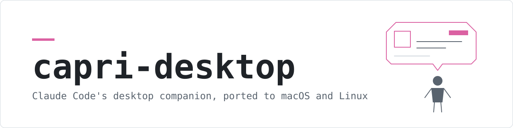
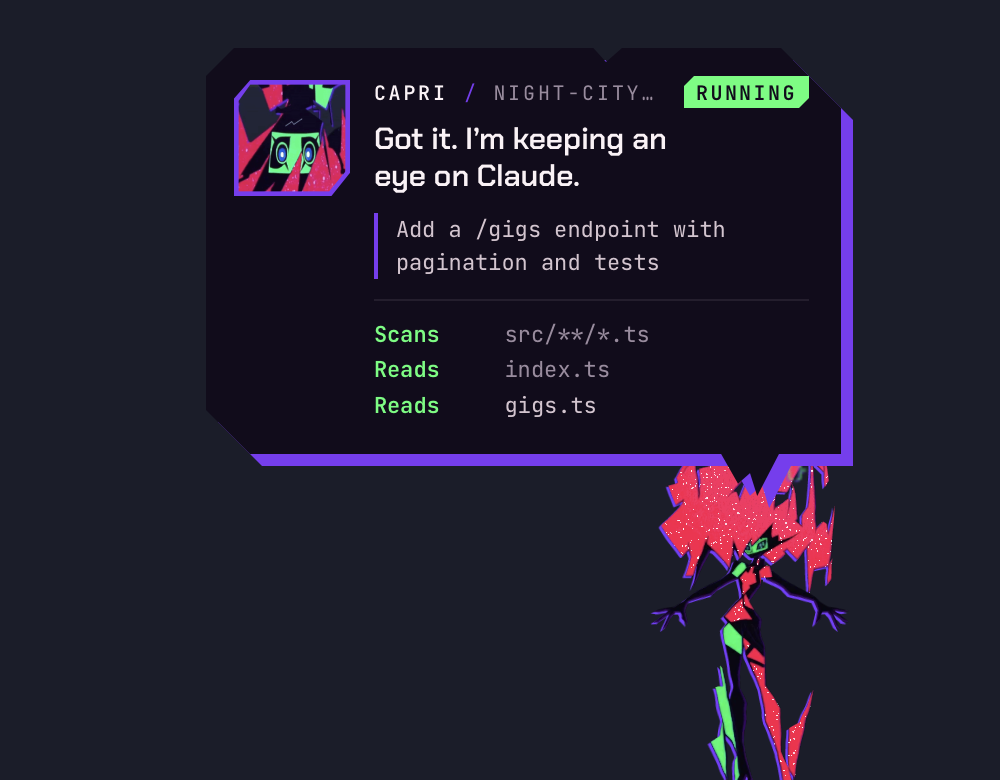

<div align="center">

<picture>
  <source media="(prefers-color-scheme: dark)" srcset="docs/assets/banner-dark.svg">
  
</picture>

# capri-desktop

### Claude Code's desktop companion, ported to macOS and Linux

**Capri sits on your screen, watches Claude Code work and tells you what it is doing.**

[](LICENSE)
[](#platforms)
[](#platforms)
[](#quick-start)
[](https://code.claude.com/docs/en/quickstart)

[Quick start](#quick-start) · [How it works](#how-it-works) · [Layout](#layout) · [Status and limits](#status-and-limits) · [Credits](#credits-and-license) · [Upstream](https://github.com/mochiiwuff/capri-desktop)

<br>




<sub>The macOS port running upstream's scripted demo session (<code>capri-ctl demo</code>): a session starts, then the prompt and Claude's first tool calls.</sub>

</div>

---

A fork of [mochiiwuff/capri-desktop](https://github.com/mochiiwuff/capri-desktop): Capri herself,
her art, her animations and almost all of the renderer in `src/renderer/` are upstream's work. This
fork takes her off Windows and Electron, onto a Wayland desktop (the mango compositor) and
natively onto macOS, and runs her chat through Claude Code. For the original Windows app, its
installer and its full feature list, go to [upstream](https://github.com/mochiiwuff/capri-desktop).

* **She narrates Claude Code as it works.** Claude Code's hook events (sessions, prompts, tool
  calls, failures, subagents) become one plate per busy agent over her head, up to three, labeled
  by session when there is more than one, with a red dot when a tool call fails.
* **She finds the agent's window and sits on it.** She walks up the agent's process tree, through
  tmux if needed, to the terminal or app it runs in.
* **Her chat runs on your Claude Code login.** Each message is one bare `claude -p` run: no tools,
  no MCP servers, no settings files, so no API key passes through her and her own hook never fires
  on her chat. Haiku by default; Ollama is the other backend.
* **She lives on the desktop.** She opens and closes apps, controls Spotify and plays a song by
  name, keeps reminders, purrs when you stroke her mane, and reacts to CPU load, battery, network
  and USB devices.
* **Native on both platforms, without Electron.** One Node service drives a Swift `NSPanel` with
  `WKWebView` on macOS and a GTK4 layer-shell overlay with WebKitGTK on Linux.

<a id="platforms"></a>

| Platform | Requires | Overlay |
|:--|:--|:--|
| &nbsp;**macOS** | `13+`, Xcode command line tools | `NSPanel` + `WKWebView` (Swift) |
| &nbsp;**Linux** | mango `0.15+`, GTK 4, gtk4-layer-shell, WebKitGTK `6.0` | wlr-layer-shell surface + WebKitGTK (Python) |

Both need Node `20+` and [Claude Code](https://code.claude.com/docs/en/quickstart), installed and
logged in.

> [!IMPORTANT]
> **Her art is not in this repository.** Capri's sprites, faces and icons are frames of the show
> and fan art that belong to their owners. `node scripts/fetch-art.js` downloads them from
> upstream at a pinned commit and checks each file against the SHA-256 in
> [`assets/art.json`](assets/art.json). The service will not start without them.

## Quick start

### macOS

The launcher and `capri-ctl` are shared with Linux, which is why they live in `linux/bin/`.

```sh
git clone https://github.com/minomat180/capri-desktop.git && cd capri-desktop
npm install --omit=dev --ignore-scripts   # her two fonts and xterm.js; Electron is not needed
node scripts/fetch-art.js                 # her art, from upstream (24 files, checked by hash)
macos/shell/build.sh                      # builds macos/shell/Capri.app
node scripts/install-hooks.js             # adds her hooks to ~/.claude/settings.json (with a backup)
linux/bin/capri                           # logs to ~/.local/state/capri/capri.log
```

Ctrl+Option+C puts her away and brings her back. `linux/bin/capri-ctl show|hide|stow|menu|chat|demo|quit`
drives her from a shell, and `macos/bin/capri-login install` starts her at login. Details, and how
each part differs from Linux: [`macos/README.md`](macos/README.md).

> [!NOTE]
> There is no prebuilt app to download. `build.sh` signs `Capri.app` ad hoc; it is not notarized.

### Linux (mango)

The service checks for mango at start. Besides the table above it needs PyGObject with pycairo and
`curl` for `capri-ctl`; `playerctl`, `rofi`, `foot`, `gtk-launch`, `tmux`, `secret-tool` and
`wl-copy` are used when present. gtk4-layer-shell is preloaded from
`/usr/lib/libgtk4-layer-shell.so.0` (Arch's path); set `CAPRI_LAYER_SHELL_LIB` elsewhere. Its
GObject typelib is vendored in `linux/shell/typelib/` for distributions that do not ship one. The
demo opens a `foot` window with app id `capri-demo`; give it a floating window rule in mango.

```sh
npm install --omit=dev --ignore-scripts
node scripts/fetch-art.js
node scripts/install-hooks.js
linux/bin/capri                           # or: linux/bin/capri --foreground
linux/bin/capri-ctl stow                  # bind this to a key in mango
```

On both platforms, restart open Claude Code sessions after installing the hooks;
`node scripts/install-hooks.js --uninstall` removes them again.

### Settings

Both ports read `~/.config/capri/config.json` (`claudeModel`, `chatBackend`, `output`, ...;
defaults in `linux/daemon/config.js`).

Playing a song by name searches Spotify's Web API with a client-credentials app. Use your own
Spotify developer app: put its id in `spotifyClientId` and store its secret as
`SPOTIFY_CLIENT_SECRET` (Linux: `secret-tool store --label=spotify service agent-vault account
SPOTIFY_CLIENT_SECRET`; macOS: read through the `agent-vault` helper the author uses, see
`macos/daemon/music.js`). Without it she falls back to a slower web search, which needs
`pip install ddgs`. Play, pause and skip work without any of this.

## How it works

Upstream is an Electron app that leans on Windows: a transparent always-on-top window, and
PowerShell to find out where the other windows are so she can sit on them. On Wayland a client
cannot see other windows or the global pointer at all. On macOS, dropping Electron means a native
overlay and `CGWindowList` in place of PowerShell. The ports keep upstream's renderer and replace
everything under it:

- **One service for both ports.** `linux/daemon/main.js` is a Node service that implements the
  `window.host` API the renderer expected from Electron, over HTTP and server-sent events on
  `127.0.0.1:47823`. The same page runs in WebKitGTK on Linux and in `WKWebView` on
  macOS. On a Mac the service swaps in `macos/daemon/` for the Linux-only modules.
- **Click-through without a shaped window.** The overlay covers the screen. The page hit-tests the
  pointer against her outline, grown by 18 px so she is easy to grab, and tells the overlay to take
  the pointer only while it is over her; every other click goes through to the desktop.
- **Windows and pointer from the compositor.** On Linux the overlay is a wlr-layer-shell surface
  (GTK4 + gtk4-layer-shell) and window positions, focus and the pointer come from mango's IPC. On
  macOS the overlay is a native `NSPanel` written in Swift (`macos/shell/main.swift`), windows come
  from `CGWindowList`, and battery, network and drives are pushed by the system instead of polled.
- **Approvals that do not go over HTTP.** The service has an approval API for an agent asking to
  use a secret. An answer is accepted only from a click in her panel, passed from the overlay to
  the service over a private pipe (fd 3), so an agent cannot approve its own request with an HTTP
  call. Nothing calls this API at the moment: the agent tools that used it were removed with the
  pi integration. See [`linux/docs/vault-approvals.md`](linux/docs/vault-approvals.md).

## Layout

```
src/renderer/        her renderer, from upstream (kept close to it so upstream changes still merge)
assets/art.json      where her art comes from: upstream commit and a SHA-256 per file
scripts/fetch-art.js fetches it into assets/capri/ and assets/icons/ (both gitignored)
hooks/capri-hook.js  the Claude Code hook: forwards a trimmed copy of each event, never blocks Claude
linux/daemon/        the service: host API, agents, chat, apps, music, machine sensors
linux/shell/         the GTK4 layer-shell overlay (Python)
macos/shell/         the macOS overlay app (Swift) and its own xterm.js terminal
macos/daemon/        macOS replacements for the Linux-only service modules
src/main/            upstream's Electron main process (Windows), unmaintained here; the
                     service still uses its ollama.js and labels.js
```

## Status and limits

- A personal project. The macOS port is the one in daily use. The Linux port was built and used
  on a ThinkPad running mango and has no live install right now.
- English only; upstream's other four languages were dropped to keep the line set small.
- Not ported from upstream on purpose: the bond system and evolving personality, custom personas,
  Codex and Antigravity support, upstream's own LLM layer, and its Windows system controls.
- No automated tests.
- Local text-to-speech (Piper and Kokoro) exists on the `feature/voice` branch, Linux only, not
  merged.
- Working notes, decisions and a survey of the other Capri projects (written for the author):
  [`linux/docs/STATUS.md`](linux/docs/STATUS.md).

## Credits and license

Capri, her art and the original app: [mochiiwuff/capri-desktop](https://github.com/mochiiwuff/capri-desktop).
The Linux and macOS ports: [minomat180](https://github.com/minomat180).

Capri / Project Capricorn, Cyberpunk and Cyberpunk: Edgerunners belong to CD PROJEKT RED, Studio
Trigger and Netflix. This is a non-commercial fan project with no affiliation. Her character art
(frames of the show, a fan-made cut-out and fan art) belongs to its owners: it is **not** in this
repository and not covered by its license. `scripts/fetch-art.js` fetches it from upstream, where
it is published. The two screenshots in `docs/` show the art as the app draws it. If a rights
holder wants anything removed, open an issue.

The code is under the [PolyForm Noncommercial License 1.0.0](LICENSE), as upstream's is: free to
use, change and share, never for sale. The upstream code this fork started from (0.3.1) was MIT,
and its notice is kept at the end of `LICENSE`. Fonts: Chakra Petch and JetBrains Mono (SIL Open
Font License). Terminal: [xterm.js](https://xtermjs.org) (MIT).
